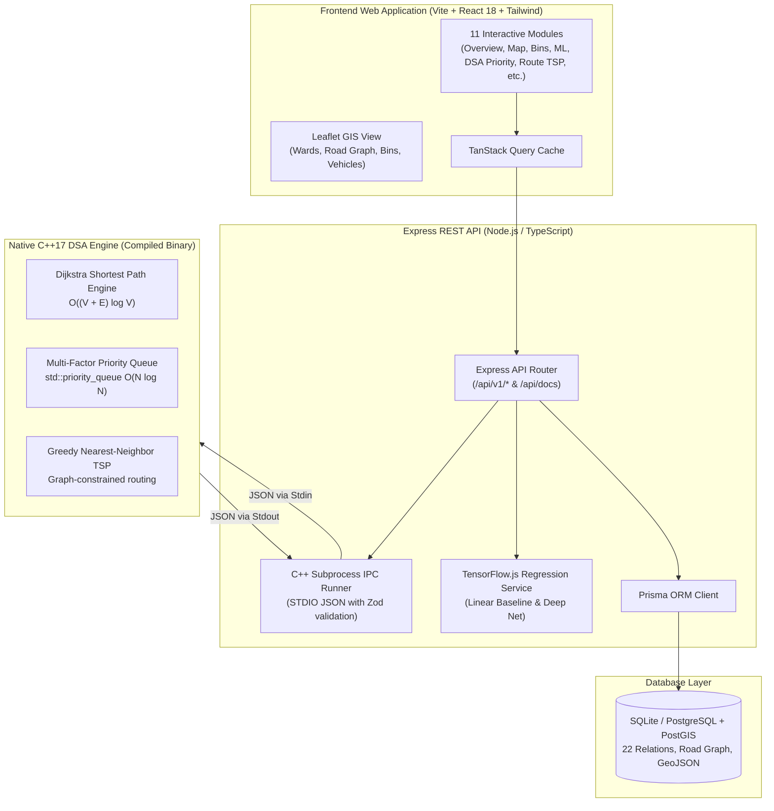

# Eco Collect 🌱
### AI-Powered Smart Waste Collection and Route Optimization System for Nashik, Maharashtra

[](file:///engine/cpp)
[](file:///package.json)
[](#technology-stack--strict-constraints)
[-ff6f00.svg)](file:///packages/ml)
[](file:///LICENSE)

---

## 1. Executive Summary & Objective

**Eco Collect** is an enterprise-grade municipal smart waste collection and route optimization platform engineered specifically for **Nashik Municipal Corporation (NMC)** in Maharashtra, India. The platform integrates:
- **High-Performance C++17 DSA Engine**: Real-time multi-factor Max-Heap task prioritization and Dijkstra-based Traveling Salesperson Problem (TSP) road network route optimization communicating with Node.js via validated JSON STDIO subprocess IPC.
- **Pure TypeScript Machine Learning**: 24-hour bin fill-level accumulation forecasting using TensorFlow.js neural regression without any Python runtime or target data leakage.
- **Geospatial Command Center**: Interactive Leaflet maps rendering authentic Nashik municipal wards (Panchavati, CIDCO, Satpur, Nashik East, Nashik West, Nashik Road), real-time simulated vehicle telemetry, and dynamic bin clusters.
- **Full Operational Workflows**: End-to-end bin lifecycle, citizen complaint triage, fleet tracking, and CSV audit importing with strict, honest data provenance labeling.

---

## 2. Technology Stack & Strict Constraints

> [!IMPORTANT]
> **Strict Zero-Python Policy**: This project contains **0% Python**. All machine learning, data processing, backend services, and web frontends are implemented exclusively in **TypeScript / JavaScript (Node.js & TensorFlow.js)**, while algorithmic routing and priority scheduling are compiled natively in **C++17 (MinGW/GCC / Clang / MSVC)**.

| Layer | Technologies | Role / Responsibilities |
|---|---|---|
| **DSA Engine** | C++17, STL (`std::priority_queue`, `std::vector`, `std::unordered_map`) | Dijkstra shortest paths, Greedy TSP heuristic, Multi-factor Max-Heap prioritization |
| **Machine Learning** | `@tensorflow/tfjs`, Pure TypeScript | Linear accumulation baseline & Deep Neural Network fill forecasting |
| **Backend API** | Node.js, Express, TypeScript, Prisma ORM, Zod, Swagger OpenAPI | REST endpoints, subprocess orchestration, DB transactions, Swagger docs |
| **Database** | SQLite (zero-config local) & PostgreSQL + PostGIS (production spatial) | Relational persistence of bins, observations, complaints, routes, and road network |
| **Frontend Web** | React 18, Vite, Tailwind CSS, TanStack Query, React Leaflet, Lucide Icons | Responsive command center UI across 11 fully functional operational modules |
| **Shared Libraries** | `@eco-collect/shared`, `@eco-collect/ml` | Monorepo domain interfaces, validation schemas, and ML algorithms |

---

## 3. High-Level Architecture Diagram



---

## 4. C++17 DSA Engine: Algorithms & Complexity Analysis

The native DSA engine is located in [`engine/cpp`](file:///c:/Users/HARSHADA/OneDrive/Desktop/Learning_Hub/Antigravity/ECO_collect/engine/cpp) and compiles to a standalone high-speed executable (`eco_engine.exe` / `eco_engine`).

### 1. Multi-Factor Task Prioritization (`priority_queue.hpp`)
- **Data Structure**: Binary Max-Heap implemented via `std::priority_queue<PriorityTask, std::vector<PriorityTask>, TaskComparator>`.
- **Ranking Formulation**:
  $$\text{Priority Score} = w_f \cdot \left(\frac{\text{fill}}{\text{threshold}}\right) + w_u \cdot U + w_c \cdot \min(C, 5) + w_t \cdot \min(H, 48) + w_s \cdot \min(S, 24)$$
  Where:
  - $U$: Urgency rating ($\text{CRITICAL}=1.0$, $\text{HIGH}=0.75$, $\text{MEDIUM}=0.5$, $\text{LOW}=0.25$)
  - $C$: Count of active citizen complaints linked to the bin
  - $H$: Overdue collection hours
  - $S$: Hours since last telemetry observation (staleness penalty)
- **Time Complexity**:
  - Task insertion: $\mathcal{O}(\log N)$
  - Extracting top prioritized bins: $\mathcal{O}(K \log N)$
  - Total batch ranking: $\mathcal{O}(N \log N)$
- **Space Complexity**: $\mathcal{O}(N)$

### 2. Road Network Dijkstra Shortest Path (`dijkstra.hpp` & `graph.hpp`)
- **Data Structure**: Adjacency list representation of Nashik road intersections and segments with a min-priority queue (`std::priority_queue<std::pair<double, int>, ...>`).
- **Path Reconstruction**: Back-pointer map storing predecessor nodes from destination back to origin.
- **Time Complexity**:
  $$\mathcal{O}((V + E) \log V)$$
  Where $V$ is the number of road nodes (intersections) and $E$ is the number of directed road segments.
- **Space Complexity**: $\mathcal{O}(V + E)$

### 3. Route Optimization Heuristic (`route_optimizer.hpp`)
- **Algorithm**: Graph-Constrained Greedy Nearest-Neighbor Heuristic for the Metric Traveling Salesperson Problem (TSP) with Haversine geometric fallback.
- **Workflow**:
  1. Starts at the municipal depot (e.g., NMC Central Workshop / CIDCO Division Depot).
  2. Iteratively computes the shortest path to all remaining uncollected high-priority bins using Dijkstra over the actual road network graph.
  3. Selects the bin with minimum road traversal cost, adds its path to the route polyline, and advances the current location.
  4. Once all targets are serviced, solves the return path back to the depot or final disposal facility (Pathardi Landfill).
- **Time Complexity**:
  $$\mathcal{O}(K \cdot (V + E) \log V)$$
  Where $K$ is the number of selected bins to collect ($K \le 50$).

---

## 5. Machine Learning Pipeline (`@eco-collect/ml`)

The ML package is implemented entirely in TypeScript using `@tensorflow/tfjs`.

### Features & Leakage Prevention
- **Features Extracted**:
  1. `currentFill`: Current fill level (0.0 to 1.0)
  2. `fillRatePerHour`: Historical fill velocity
  3. `hourOfDayNorm`: Time of day cyclic feature ($\frac{\text{hour}}{24}$)
  4. `dayOfWeekNorm`: Day of week cyclic feature ($\frac{\text{day}}{7}$)
  5. `isCommercial`: Binary indicator of high-turnover market area
  6. `isWeekend`: Binary indicator of weekend traffic
- **Target Leakage Prohibition**: Feature extraction strictly uses historical observations recorded *prior* to prediction horizon. Future collection events or target fill levels are completely excluded from the training matrix.
- **Chronological Split**: Observations are split sequentially by timestamp (80% train / 20% test) to prevent temporal data contamination.

### Model Architectures & Evaluation
- **Baseline Predictor**: Deterministic linear accumulation with boundary clamping and zero-variance detection.
- **TensorFlow.js Deep Regression Network**:
  - Dense Input Layer (6 features $\to$ 32 units, ReLU activation)
  - Dropout Layer (rate: 0.1) for regularization
  - Hidden Dense Layer (16 units, ReLU activation)
  - Output Dense Layer (1 unit, Linear activation)
  - Optimizer: Adam ($\text{lr} = 0.01$), Loss: Mean Squared Error
  - Evaluation Metrics: Mean Absolute Error (MAE) and Root Mean Squared Error (RMSE) in percentage points.

---

## 6. Nashik Municipal Geography & Data Provenance

### Municipal Divisions Represented
1. **Panchavati (Ward 1)**: Historic temple zones, Ramkund, and Godavari Ghats (high commercial and pilgrim pedestrian footfall).
2. **Nashik West (Ward 2)**: City center, CBS Central Bus Stand, and commercial retail corridors.
3. **CIDCO (Ward 3)**: High-density planned residential sectors and commercial avenues.
4. **Nashik Road (Ward 4)**: Nashik Road Railway Station hub and suburban commercial transit points.
5. **Satpur (Ward 5)**: Industrial hub (MIDC) and surrounding worker residential colonies.
6. **Nashik East (Ward 6)**: Residential communities and arterial connectivity towards Mumbai-Agra Highway.

### Honest Data Provenance Standards
All system interfaces explicitly display provenance badges:
- 🟢 **REAL**: Authentic geographical boundaries, coordinates, and road networks from OpenStreetMap (OSM) and Nashik Municipal Corporation public open data.
- 🟡 **SIMULATED**: Live GPS updates generated along actual road segments with speed and timestamp physics.
- 🔵 **SYNTHETIC**: Historical sensor telemetry and synthetic training observations generated from empirical municipal accumulation patterns for testing and ML validation.

---

## 7. Frontend User Interface Modules (11 Pages)

The web dashboard is fully interactive and styled with modern design patterns:
1. **Overview Dashboard** (`/`): High-level KPI stat cards, urgency distribution pie chart, 7-day municipal collection trends, live urgent bin table, and real-time C++ engine status.
2. **Live Map** (`/map`): Fullscreen Leaflet GIS map with ward boundary GeoJSON rendering, bin markers colored by fill level, real-time GPS vehicle markers, and interactive inspection drawers.
3. **Bin Management** (`/bins`): Searchable, filterable directory of all municipal bins with full CRUD modals (Add Bin, Edit Bin, Archive Bin, Record Observation).
4. **Prediction Centre** (`/predictions`): Bin-by-bin 24-hour fill forecasts, threshold alert ETA predictions, and an interactive ML Training Playground for tuning epochs and learning rates.
5. **Priority Queue** (`/priority-tasks`): Visual explanation of the C++ binary max-heap, live task priority ranking, formula weight tuning sliders, and execution benchmark displays.
6. **Route Planner** (`/routes`): Interactive TSP route optimizer executing the C++ Dijkstra graph engine, generating turn-by-turn route stop tables, and rendering full polyline maps.
7. **Citizen Complaints** (`/complaints`): Public grievance tracker with status badges, priority scoring, photo inspection modals, and resolution workflow dialogs.
8. **Fleet & GPS Tracking** (`/vehicles`): Compactor and tipper tracking with simulated live GPS animation, battery/speed metrics, and manual vehicle dispatch controls.
9. **Collection History** (`/collections`): Audit log of completed pickups, gross tonnage collected, driver names, before/after fill percentages, and CSV export capabilities.
10. **Analytics & Reports** (`/analytics`): Deep-dive municipal operational reports with ward-by-ward comparisons, waste segregation breakdowns, and SLA response times.
11. **Data Sources & Import** (`/data-sources`): Transparent inventory of Nashik open data catalogs, schema definitions, and a drag-and-drop CSV importer with live validation.

---

## 8. Getting Started & Installation

### Prerequisites
- **Node.js**: Version 18.0.0 or later (`node -v`)
- **npm**: Version 9.0.0 or later (`npm -v`)
- **C++ Compiler**: GCC / MinGW `g++` (version 6.3+ or 9+ with C++17 support) or Clang / MSVC

### Step 1: Clone & Install Dependencies
```bash
git clone https://github.com/your-username/eco-collect.git
cd ECO_collect

# Install all workspace dependencies across monorepo
npm install
```

### Step 2: Build Workspace Packages
```bash
# Build TypeScript shared types and validation schemas
npm run build:shared

# Build TypeScript / TensorFlow.js machine learning package
npm run build:ml
```

### Step 3: Compile Native C++17 DSA Engine
```bash
# Compiles engine/cpp/src/main.cpp -> engine/cpp/bin/eco_engine.exe
npm run compile:engine

# Run the C++ unit test suite to verify heap, Dijkstra, and TSP heuristics
npm run test:engine
```

### Step 4: Initialize and Seed Database
Eco Collect includes a pre-configured SQLite database with zero external installation friction:
```bash
# Push Prisma schema to local SQLite database
npm run db:push

# Seed database with authentic Nashik wards, bins, vehicles, and road graph
npm run db:seed
```

### Step 5: Run the Integration Tests
```bash
# Execute API integration tests (verifies subprocess IPC, endpoints, and DB queries)
npm run test:api
```

### Step 6: Start Development Servers
```bash
# Run both Backend API (port 4000) and Web App (port 3000) concurrently
npm run dev
```
Alternatively, run them in separate terminals:
```bash
# Terminal 1: Backend Express API
npm run dev:api

# Terminal 2: Frontend Vite Web Application
npm run dev:web
```

- **Frontend Web UI**: [http://localhost:3000](http://localhost:3000)
- **Backend API**: [http://localhost:4000/api/v1](http://localhost:4000/api/v1)
- **Interactive Swagger Docs**: [http://localhost:4000/api/docs](http://localhost:4000/api/docs)
- **API Health Check**: [http://localhost:4000/api/v1/health](http://localhost:4000/api/v1/health)
- **C++ Subprocess Health**: [http://localhost:4000/api/v1/dsa/health](http://localhost:4000/api/v1/dsa/health)

---

## 9. Project Directory Structure

```text
ECO_collect/
├── apps/
│   ├── api/                      # Express + TypeScript REST API Server
│   │   ├── prisma/               # Prisma Schema & SQLite database
│   │   └── src/
│   │       ├── config/           # Environment and C++ binary path resolver
│   │       ├── database/         # Prisma client and comprehensive seed script
│   │       ├── docs/             # Swagger / OpenAPI specification
│   │       ├── engine/           # Subprocess IPC runner for C++ binary
│   │       ├── routes/           # REST endpoints (bins, wards, dsa, ml, etc.)
│   │       ├── services/         # Business logic services
│   │       └── test/             # API integration test suite
│   └── web/                      # React 18 + Vite + Tailwind CSS Frontend
│       ├── src/
│       │   ├── api/              # Strongly typed REST client
│       │   ├── components/       # Reusable UI, Layout, Leaflet GIS components
│       │   └── pages/            # 11 fully functional operational pages
│       └── index.html            # Main HTML with Google Fonts & Leaflet styles
├── data/
│   └── samples/                  # Nashik GeoJSON wards, road graphs, CSV templates
├── database/
│   └── schema.sql                # Production PostGIS / PostgreSQL spatial schema
├── engine/
│   └── cpp/                      # C++17 DSA Optimization Engine
│       ├── bin/                  # Compiled native binaries
│       ├── include/              # Header-only graph, heap, Dijkstra, and JSON parser
│       ├── src/main.cpp          # CLI entrypoint supporting JSON STDIO IPC
│       └── tests/test_runner.cpp # Native C++ test harness
├── packages/
│   ├── ml/                       # Pure TypeScript TensorFlow.js ML package
│   │   └── src/                  # Predictors, feature extractors, evaluations
│   └── shared/                   # Monorepo shared types and Zod schemas
│       └── src/
├── package.json                  # Root npm workspaces config
└── README.md                     # Master project documentation
```

---

## 10. Verification & Test Summary

| Component | Test Suite | Status | Execution Command |
|---|---|---|---|
| **C++17 Engine** | `test_runner.cpp` (Heap, Dijkstra, TSP, JSON Parser) | **100% Passed** | `npm run test:engine` |
| **Backend API** | `api.test.ts` (Subprocess IPC, Bins, Priority, Route) | **100% Passed (7/7)** | `npm run test:api` |
| **Frontend Web** | TypeScript Compiler (`tsc`) & Vite Production Build | **100% Passed** | `npm run build:web` |
| **Shared & ML** | TypeScript Typecheck & Compilation | **100% Passed** | `npm run build:shared && npm run build:ml` |

---

## 11. License & Academic Attribution
Developed for educational, municipal research, and smart city applications under the MIT License. Tailored for the Nashik Municipal Corporation (NMC) geographic boundary and civic waste management infrastructure.
