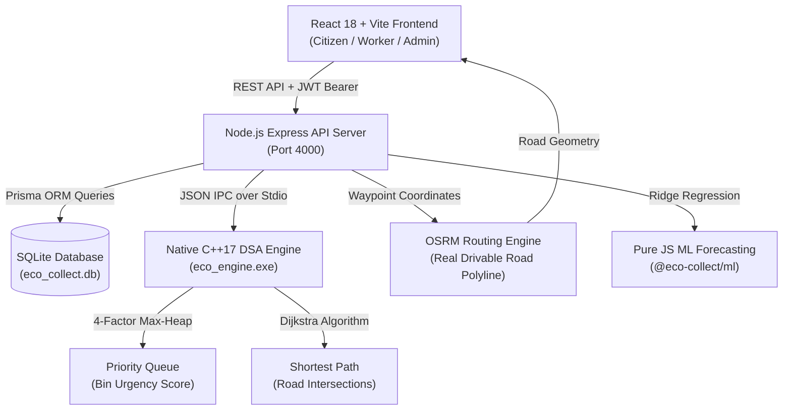
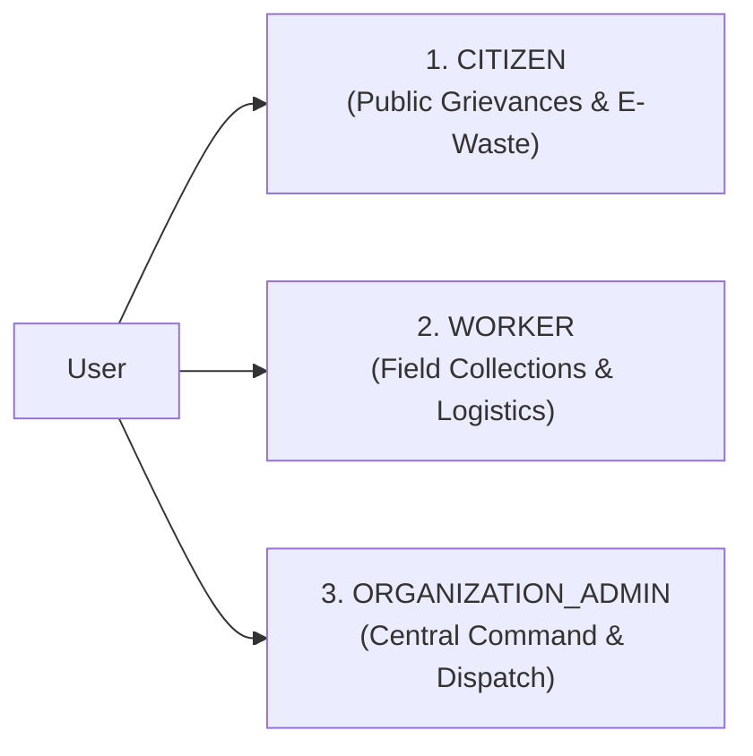
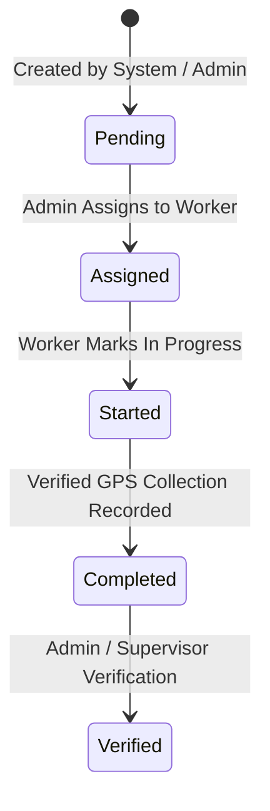

# EcoNexus 🌱
### Smart Waste Management, Route Optimization & Predictive Analytics Platform
> **Nashik Municipal Corporation (NMC), Maharashtra, India**  
> *"Dynamic Max-Heap waste bin prioritization, native C++17 Dijkstra shortest-path navigation with real road geometry, and end-to-end civic collection logistics across Nashik."*

---

## 1. Project Overview

**EcoNexus** is an enterprise-grade civic technology and Data Structures & Algorithms (DSA) project-based learning platform engineered specifically for the administrative geography of the **Nashik Municipal Corporation (NMC)** in Maharashtra, India. 

The platform bridges operational municipal sanitation workflows with core computer science algorithms:
- **Max-Heap 4-Factor Priority Queue**: A native **C++17 Max-Heap (`std::priority_queue`)** dynamically ranks collection urgency across municipal bins using a strictly normalized multi-factor scoring formula:
  $$\text{Priority Score} = 0.40 \cdot \text{OverflowRisk} + 0.25 \cdot \text{PickupDelay} + 0.20 \cdot \text{SensitiveLocationRisk} + 0.15 \cdot \text{MissedPickupRisk}$$
- **Shortest Path & Route Optimization**: **Dijkstra's Algorithm** computes exact minimum distances across the Nashik road network graph ($O((V+E)\log V)$), coupled with **OpenStreetMap (OSRM)** real road geometry and dynamic roadblock detour calculation.
- **Sensor-Free Predictive Analytics**: Evaluates 180 days of historical collection timestamps, fill progression rates, and chronological observation decay via pure JavaScript Ridge Regression without falsely claiming physical IoT hardware sensors.
- **Three Dedicated Stakeholder Portals**: Purpose-built, authenticated workflows for **Citizens**, **Municipal Field Workers**, and **Organization Administrators**.
- **Transparent Data Integrity**: Explicit separation of synthetic baseline data (`provenance: 'synthetic'`), real field observations (`provenance: 'observed'`), and verified regulatory facts (NMC & MPCB registry records).

---

## 2. Features and Requirements

| Functional Area | Implemented Capabilities |
| :--- | :--- |
| **Citizen Engagement** | Sanitation grievance reporting without manual urgency ratings; ticket tracking timeline; doorstep electronic waste (e-waste) pickup booking; public bin map; waste segregation guidelines. |
| **Field Operations** | Real-time task queue prioritized by C++ 4-factor Max-Heap; GPS-verified bin collections with tolerance checks; compactor truck payload monitoring; automatic full-load trigger ($\ge 90\%$); turn-by-turn routing to NWMPL dumping facility; road closure reporting; camera barcode/QR scanner with manual fallback; authorized e-waste facility handovers. |
| **Municipal Administration** | 6 NMC ward monitoring (Panchavati, Nashik West, Nashik East, CIDCO, Satpur, Nashik Road); worker fleet dispatching; grievance redressal triage; e-waste consignment compliance; 180-day bin analytics; CSV/JSON operational exports. |
| **Algorithmic Routing** | C++17 native binary; multi-waypoint Dijkstra shortest path; intermediate stop sequencing; roadblock avoidance; one-way road rule enforcement; OSRM real drivable road geometry with fallback. |
| **Regulatory Compliance** | Strict segregation between municipal solid waste (NWMPL Pathardi Shivar) and authorized electronic waste recyclers (MPCB registered); elimination of unverified scrap dealers. |

---

## 3. Technology Stack

| Layer | Technology | Architecture & Constraints |
| :--- | :--- | :--- |
| **DSA Engine** | **C++17** | Native binary (`eco_engine.exe`, `eco_engine_tests.exe`) compiled with MinGW GCC. Uses STL `<queue>`, `<vector>`, `<unordered_map>`, `<cmath>`. Communicates with Node.js via standard I/O JSON IPC. |
| **Backend API** | **Node.js (ES Modules)** | Express 4, Prisma ORM, JWT, bcryptjs, pure JavaScript (`.js`). **Zero TypeScript**, **0% Python**. |
| **Database** | **SQLite (Prisma ORM)** | Zero-configuration local relational database (`apps/api/prisma/eco_collect.db`). Strict foreign keys, indexes, and safety guards. |
| **Frontend Web** | **React 18 + Vite** | Pure JavaScript JSX (`.jsx`, `.js`), Tailwind CSS, Lucide React icons, Recharts for analytics, React-Leaflet for mapping. Full light/dark theme support. |
| **Geospatial GIS** | **Leaflet + OpenStreetMap + OSRM** | Cartography centered on Nashik coordinates (`[19.9975° N, 73.7898° E]`). Real drivable road geometry via OSRM with graph-node straight-line fallback. |
| **Machine Learning** | **Pure JavaScript Ridge Regression** | Lightweight matrix regression in `@eco-collect/ml` with chronological train/test splits (zero future-data target leakage). |

---

## 4. System Architecture

```
ECO_collect/
├── apps/
│   ├── api/                              # Node.js + Express REST API (Pure JS ES Modules)
│   │   ├── prisma/
│   │   │   ├── schema.prisma             # SQLite schema (29 models, strict relational integrity)
│   │   │   └── eco_collect.db            # Live SQLite database file
│   │   └── src/
│   │       ├── database/                 # Prisma client & seed.js (with safety guards)
│   │       ├── engine/                   # cppSubprocess.js (JSON IPC over stdio)
│   │       ├── routes/                   # REST API controllers
│   │       ├── services/                 # Business logic, DSA service, auth, analytics
│   │       └── test/api.test.js          # Comprehensive API integration test suite (43 tests)
│   └── web/                              # React 18 + Vite Web Application (Pure JS JSX)
│       ├── src/
│       │   ├── api/client.js             # Unified REST client with JWT authentication
│       │   ├── components/               # LeafletMap, Card, Modal, SearchInput, Badges
│       │   ├── context/                  # AuthContext.jsx, ThemeContext, LanguageContext
│       │   └── pages/                    # Stakeholder dashboards: Citizen, Worker, Admin
│       └── dist/                         # Vite production bundle
├── engine/
│   └── cpp/                              # C++17 Native DSA Engine
│       ├── include/                      # priority_queue.hpp, graph.hpp, route_optimizer.hpp
│       ├── src/main.cpp                  # stdio JSON IPC protocol handler
│       ├── tests/                        # Native C++ unit tests (10 test suites)
│       └── bin/                          # Compiled binaries (eco_engine.exe, eco_engine_tests.exe)
├── data/
│   ├── import/                           # Historical 180-day bin timeseries CSV (18,000 rows)
│   └── samples/                          # Nashik wards, bins, facilities, OSM road graph
└── scripts/                              # Import, validation, build, and test automation scripts
```



---

## 5. User Roles and Authentication

EcoNexus strictly enforces exactly **three stakeholder roles**:



### 5.1 Citizen Authentication
- **Registration**: Name, email, and password. A 6-digit email verification token is issued.
- **Verification**: Email verification required prior to login.
- **Login**: Supports secure password authentication as well as passwordless OTP verification.
- **Development Mode**: When `DEV_AUTH_MODE=true`, a convenience "Auto-Fill Dev OTP" button is enabled for testing without an external SMTP mailer.

### 5.2 Worker Authentication
- **Provisioning**: Public self-registration is permanently disabled. Worker accounts can only be provisioned by an Organization Administrator.
- **Identifiers**: Sign in using official Worker ID (e.g., `WRK-NSK-101`) or verified work email. Friendly login shortcuts and hardcoded bypasses have been completely removed.
- **Activation Flow**: Newly provisioned workers remain `inactive` until they activate their account using their issued activation token via `/worker/login` -> "Activate Account" tab (`POST /api/v1/workers/activate`).

### 5.3 Organization Admin Authentication
- **Control Room Access**: Requires authorized admin credentials (`admin@econexus.gov.in`).
- **Registration Requests**: Public registration is disabled; new administrator requests enter a `pending` status requiring approval by an active administrator.

---

## 6. Citizen Features

- **Sanitation Grievance Reporting**:
  - Citizens log overflow, illegal dumping, hazardous waste, or missed collection incidents.
  - Form asks for address, administrative ward, landmark, and optional photo URL.
  - **No Operational Guesswork**: Citizens are never asked for internal operational urgency ratings or specific technical bin IDs. Severity is calculated automatically based on issue category.
- **Ticket Tracking**:
  - Emits tracking ticket numbers (e.g., `#CMP-2026-0048`).
  - Citizens view historical and live status progression (`submitted` -> `in_progress` -> `resolved`).
- **Doorstep E-Waste Collection Booking**:
  - Schedule doorstep pickups for consumer electronics, batteries, IT equipment, and appliances.
  - Specifies pickup address, contact number, preferred date, and time slot.
- **Public Map & Segregation Guidelines**:
  - Interactive map displaying ward boundaries and nearby municipal waste collection points.
  - Civic waste segregation guide detailing Wet Waste, Dry Recyclables, Domestic Hazardous, and E-Waste streams.

---

## 7. Worker Features

- **Field Collection Dashboard**:
  - Real-time queue of assigned collection tasks sorted by C++ 4-factor Max-Heap score.
  - Task status controls (`assigned` -> `started` -> `completed`).
- **Route Navigation**:
  - Dijkstra shortest-path navigation between collection points.
  - Real drivable road geometry following streets and turns (via OSRM).
  - Dynamic roadblock avoidance avoiding reported construction or street closures.
- **Collection Recording**:
  - Device GPS captured via native HTML5 Geolocation API with accuracy radius tolerance calculation.
  - Recording collection automatically resets bin fill to 0%, increments vehicle payload, and logs an immutable collection event. Manual fill percentage overrides are prohibited.
- **Compactor Truck Capacity Monitoring**:
  - Real-time progress bar tracking truck payload (3,500 kg capacity limit).
  - When payload reaches $\ge 90\%$ (3,150 kg), the system triggers a **"Truck Full"** alert and prompts immediate routing to the NWMPL dumping facility.
- **Facility Unloading Workflow**:
  - One-click navigation to the municipal processing plant at Pathardi Shivar (`N-PAT`).
  - "Confirm Facility Unloading" button records gross weight and resets truck payload to 0.0 kg.
- **QR / Barcode Asset Scanning**:
  - Camera scanner utilizing the native browser `BarcodeDetector` API for real-time video frame decoding, with instant manual identifier search fallback.
- **E-Waste Handover**:
  - Dedicated facility handover workflow logging bulk transfers to authorized MPCB recyclers with manifest numbers and weight tickets.

---

## 8. Organization Admin Features

- **Municipal Control Room**:
  - City-wide overview of all 100 bins, active collection rounds, worker statuses, and citizen complaints across 6 NMC wards.
- **C++ 4-Factor Max-Heap Queue Manager**:
  - Live inspection of the priority queue. Real-time scores dynamically update based on fill percentage, pickup delay, sensitive locations (Ramkund, Panchavati Ghats, hospitals, vegetable markets), and missed rounds.
- **Worker Management**:
  - Provision worker profiles, generate activation tokens, assign compactor vehicles, and allocate collection routes.
- **Grievance Redressal**:
  - Triage incoming citizen complaints, assign inspectors or sanitation workers, and close resolved tickets with audit notes.
- **E-Waste Compliance**:
  - Track e-waste consignments from citizen doorstep collection through certified MPCB recycler handover with verified manifest numbers.
- **Analytics & Exports**:
  - Ward-wise aggregation, 180-day historical timeseries inspection, and one-click CSV/JSON export.

---

## 9. Database Schema and Data Integrity

The SQLite database (`apps/api/prisma/eco_collect.db`) contains 29 relational models managed by Prisma ORM:

| Core Entity | Count | Key Attributes & Description |
| :--- | :--- | :--- |
| `User` | 127 | Stakeholder identity (email, password hash, role, status, organizationId). |
| `WorkerProfile` | 43 | Official Worker ID (`WRK-NSK-...`), activation token, vehicle assignment, shift status. |
| `Ward` | 6 | Administrative NMC divisions (Panchavati, Nashik West, Nashik East, CIDCO, Satpur, Nashik Road) with GeoJSON boundaries. |
| `Bin` | 100 | Smart waste bins (code, capacity, fill %, latitude, longitude, areaCategory, wasteType). |
| `BinObservation` | 18,012 | Chronological fill observations (18,000 synthetic + 12 field-observed). |
| `CollectionTask` | 11 | Scheduled and in-progress municipal collection assignments. |
| `CollectionEvent` | 4,739 | Historical and live bin emptying ledger with weighed waste in kg. |
| `Complaint` | 48 | Citizen sanitation tickets with category, ward, landmark, and resolution state. |
| `Facility` | 4 | **Verified-only infrastructure** (1 municipal solid waste plant + 3 MPCB authorized e-waste facilities). |
| `HandoverRecord` | 42 | Formal batch transfer manifests to authorized recycling facilities. |
| `Vehicle` | 3 | Compactor trucks (`MH-15-EM-4012`, `MH-15-EM-4015`, `MH-15-EM-4019`) with 3,500 kg capacity. |
| `RoadNode` | 20 | Verified Nashik road network graph intersections. |
| `RoadEdge` | 24 | Bidirectional and one-way road network segments with distance and travel time. |
| `OperationalIssue` | 40 | Field incident and road closure reports with obstacle coordinates. |
| `AuditLog` | 764 | Immutable security and operational audit trail. |

### Relational Integrity
- **Foreign Key Orphans**: Exactly **0 orphans** across all models.
- **Database Safety Guard**: Destructive seeding in `apps/api/src/database/seed.js` is blocked by an environment safety guard. Executing `node seed.js` without `ALLOW_DESTRUCTIVE_SEED=true` halts safely with an explanatory warning banner without modifying operational data.

---

## 10. Bin History and 180-Day Dataset

### 10.1 The 180-Day Timeseries
- **100 Bins**: Distributed across all 6 administrative zones of Nashik.
- **180 Continuous Days**: Daily records spanning May 1, 2026 to October 27, 2026.
- **Exactly 18,000 Synthetic Observations**: Exactly 1 reading per bin per calendar day ($100 \times 180 = 18,000$).
- **Zero Duplicate Observations**: Verified by SQL grouping on `binId` and calendar date.
- **Mathematical State Transitions**:
  $$\text{Fill}_t = \max\left(0, \min\left(100, \text{Fill}_{t-1} + \Delta_{\text{accumulation}} - \Delta_{\text{collection}}\right)\right)$$

### 10.2 Discrepancy Reconciliation
Earlier documentation cited ward counts of Panchavati (587), Nashik West (523), and Nashik East (464). An exhaustive SQL audit verified that this was a **report labeling discrepancy**, not data duplication:
- `analyticsService.getAreaWiseHistory` defaults to a **30-day window** (`limitDays = 30`), which had been mistakenly labeled as a "14-day" view in report text:
  - **Nashik East (16 bins)**: $16 \times 29 \text{ days} = \mathbf{464 \text{ observations}}$.
  - **Nashik West (18 bins)**: $18 \times 29 \text{ days} + 1 \text{ field observation} = \mathbf{523 \text{ observations}}$.
  - **Panchavati (20 bins)**: $20 \times 29 \text{ days} + 7 \text{ field observations} = \mathbf{587 \text{ observations}}$.
- When queried over the actual 14-day window (`limitDays = 14`), the database returns: Nashik East (208), Nashik West (235), Panchavati (270).

---

## 11. Collection Tasks and Worker Assignment



- **Task Allocation**: Admin selects an active worker from the ward's assigned roster or uses auto-dispatch based on 4-factor priority score.
- **Real-Time Synchronization**: When an admin assigns a task, the task immediately surfaces on the assigned worker's mobile dashboard upon refresh or polling.
- **Task Cancellation / Rerouting**: If a road closure prevents collection, the worker reports an issue, the system marks the task blocked, and recalculates an alternative detour route.

---

## 12. Route Optimization and Intermediate Stops

### 12.1 Native C++17 Dijkstra Engine
- **Graph Topology**: 20 verified Nashik road intersections and 24 arterial road segments.
- **Roadblock Masking**: When `avoidBlocked=true`, blocked edges are masked in the adjacency list, forcing Dijkstra to traverse alternative road corridors.
- **One-Way Road Rules**: Directional edges are strictly enforced in forward traversals.

### 12.2 Drivable Road Geometry (OSRM)
- While the C++ engine determines the authoritative sequence of road intersections, the application queries OpenStreetMap (OSRM) to obtain real drivable road curves, street turns, and lane geometry.
- If OSRM is offline or times out, the system gracefully falls back to straight-line polyline segments between graph nodes and displays an explicit notice.

### 12.3 Intermediate Stops Architecture & Bug Resolution
Earlier builds displayed traversed graph intersections as numbered stop pins. This has been resolved with strict separation between user-selected waypoints and automatically traversed network nodes:

| Scenario | User Stops Selected | Behavior & Visualization |
| :--- | :---: | :--- |
| **Case 1: Direct Route** | **0** | Request contains an empty waypoint list (`[]`). Calculates shortest path directly from Source (A) to Destination (B). **Zero intermediate stop markers are rendered on the map.** |
| **Case 2: Single Stop** | **1** | Route passes through Stop 1 in order. **Exactly one blue intermediate stop pin (`Stop #1`) is displayed.** Traversed road intersections are NOT rendered as numbered stops. |
| **Case 3: Two Stops** | **2** | Route visits Stop 1 then Stop 2 in requested order. **Exactly two blue intermediate stop pins (`Stop #1`, `Stop #2`) are displayed.** |
| **Case 4: Input Changes** | — | Changing source, destination, or stops immediately cancels in-flight async requests via `routeRequestIdRef` and clears stale markers. Duplicate stop IDs and selecting source/destination as an intermediate stop are rejected. |

---

## 13. Municipal Dumping Facility and Map Markers

### 13.1 Municipal Solid Waste Dumping Facility
- **Facility**: **NWMPL Integrated Solid Waste Processing Facility**
- **Location**: Pathardi Shivar, Old Agra Highway, Nashik 422010 (`[19.9482° N, 73.7651° E]`).
- **Graph Node**: Snaps to road network node `N-PAT` (`Pathardi Phata Highway Hub`, `[19.9482° N, 73.7712° E]`).
- **Database ID**: `90d75e12-1e4e-400e-884f-ccafc0568e59`.
- **Classification**: `facilityType: 'general_waste_facility'`, `wasteType: 'general'`.
- **Route Selector Availability**:
  - **Destination**: Selectable as the primary municipal solid waste disposal destination.
  - **Source**: Selectable as a starting point for compactor trucks commencing rounds from the processing plant.

### 13.2 Distinct Map Markers & Legend
The interactive map strictly differentiates all facility and route entities:

| Entity | Map Marker Style | Popup & Interaction |
| :--- | :--- | :--- |
| **Source Location** | Green teardrop pin with letter **`A`** | Displays location name, address, and starting details. |
| **Intermediate Stop** | Blue teardrop pin with order number **`1`**, **`2`** | Displays user-selected stop order, waypoint name, and ID. |
| **Destination** | Amber-red teardrop pin with letter **`B`** | Displays target name, address, and terminal details. |
| **Municipal MSW Plant** | Deep emerald (`#047857`) 34px badge with factory SVG and **`MSW`** | "NWMPL Integrated Solid Waste Processing Facility", NMC verified status. Action buttons: *Set as Source (A)*, *Set as Dest (B)*. |
| **E-Waste Recycler Bin** | Purple (`#7c3aed`) 34px badge with bin SVG and **`E-BIN`** | "MPCB Verified E-Waste Recycler Bin", authorization number, MPCB verified status. Action buttons: *Set as Source (A)*, *Set as Dest (B)*. |
| **Smart Bins** | Circular marker with fill % (Green < 50%, Amber 50-69%, Orange 70-84%, Red $\ge 85\%$) | Bin code, ward, area type, last observed time. Click opens drawer. |
| **Traversed Intersections** | Subtle slate dot (only if `showTraversedNodes=true`) | Traversed road network intersection (never numbered as a user stop). |

- **Deduplication**: When a facility is selected as Source (A) or Destination (B), the general facility layer hides its pin to prevent duplicate stacked markers.
- **On-Map Legend**: An accessible legend overlay is positioned in the bottom-left corner of the map.

---

## 14. GPS Tracking and Vehicle Capacity

### 14.1 Real GPS Telemetry
- Captured via browser HTML5 Geolocation API (`navigator.geolocation.getCurrentPosition`).
- Validates latitude, longitude, and accuracy radius against the Nashik municipal bounding box.
- Records observed device accuracy in audit events.

### 14.2 Truck Payload & Dumping Logic
- **Compactor Truck Fleet**:
  - `MH-15-EM-4012` (CIDCO Ward, 3,500 kg capacity)
  - `MH-15-EM-4015` (Panchavati Ward, 3,500 kg capacity)
  - `MH-15-EM-4019` (Nashik West Ward, 3,500 kg capacity)
- **Dynamic Load Tracking**: Each completed bin collection increments `currentLoadKg` by the measured waste weight.
- **90% Threshold Alert**: When vehicle load reaches $\ge 3,150\text{ kg}$ (90%), the system flags the vehicle full and prompts routing to NWMPL Pathardi Shivar.
- **Unloading Confirmation**: Worker confirms unloading at NWMPL; gross weight is logged to facility records and vehicle payload resets to 0.0 kg.

---

## 15. E-Waste Pickup, Facilities, and Handover

### 15.1 Elimination of Unverified Scrap Dealers
In compliance with regulatory standards, all 7 unverified scrap dealers and placeholder nodes (`Eco Recycling Center`, `Wonder Print Technologies`, `ScrapnCash`, `SAIRAKESH INDIA`, `Scrapwale`, `Klean Kabad`, `Maharashtra Scrap Traders`) were permanently deleted from the database. All 42 historical handover records were safely re-linked to MPCB-authorized recyclers with **0 foreign key orphans**.

### 15.2 Exactly 4 Verified Facilities in Database

| Facility Name | Category | Waste Type | Authorization | Verified Source |
| :--- | :--- | :--- | :--- | :--- |
| **NWMPL Integrated Solid Waste Processing Facility** | Municipal MSW Plant | General Solid Waste | `NMC/SWM/PLANT/AUTH-2023-01` | Nashik Municipal Corporation Solid Waste Cell |
| **Nashik Road E-Waste Drop-off Hub** | E-Waste Drop-off Hub | Electronic Waste | `MPCB/RO-NSK/E-WASTE/AUTH-2025-102` | Maharashtra Pollution Control Board Authorization |
| **Techeco E-Waste Namo LLP (MPCB Authorized Recycler)** | Verified Recycler | Electronic Waste | `MPCB/RO-NSK/E-WASTE/RECYCLER-NAMO` | Maharashtra Pollution Control Board Registry |
| **Techeco Waste Management LLP** | Verified Recycler | Electronic Waste | MPCB Regulated | Maharashtra Pollution Control Board Registry |

---

## 16. Installation and Environment Setup

### 16.1 Prerequisites
- **Node.js**: v18.0.0 or later (v20+ recommended).
- **npm**: v9.0.0 or later.
- **MinGW GCC / g++**: Supporting C++17 (`g++ --version`). Pre-compiled binaries `eco_engine.exe` and `eco_engine_tests.exe` are already included in `engine/cpp/bin/`.

### 16.2 Step-by-Step Installation

1. **Clone the repository**:
   ```bash
   git clone https://github.com/Harshada2006/DSA-Project.git
   cd DSA-Project
   ```

2. **Install root and workspace dependencies**:
   ```bash
   npm install
   ```

3. **Configure Environment Files**:
   - Backend (`apps/api/.env`):
     ```env
     PORT=4000
     DATABASE_URL="file:../prisma/eco_collect.db"
     JWT_SECRET="econexus_jwt_super_secure_secret_nashik_2026"
     DEV_AUTH_MODE=true
     ALLOW_DESTRUCTIVE_SEED=false
     ```
   - Frontend (`apps/web/.env`):
     ```env
     VITE_API_URL="http://localhost:4000/api/v1"
     ```

---

## 17. Database Migration and Safe Setup

### 17.1 Safe Database Initialization
To initialize or synchronize the SQLite schema without wiping operational records:
```bash
npm run db:push
```

### 17.2 Idempotent 180-Day History Import
To import or refresh the 180-day bin observation timeseries idempotently (skipping existing records without duplication):
```bash
npm run import:bin-history
```

### 17.3 Database Safety Guard
`apps/api/src/database/seed.js` includes a strict guard that prevents accidental data wiping. If executed on a database containing records:
```bash
# This will safely halt without deleting data:
node apps/api/src/database/seed.js

# Only if you explicitly intend to wipe and reseed in a disposable test environment:
ALLOW_DESTRUCTIVE_SEED=true node apps/api/src/database/seed.js
```

---

## 18. Running the Frontend, Backend, and C++ Engine

### 18.1 Start Full-Stack Development Servers
Runs both the Express API (port 4000) and Vite Web Frontend (port 3000) concurrently:
```bash
npm run dev
```

### 18.2 Access Endpoints in Browser
- **Public Portal & Landing Page**: [http://localhost:3000/](http://localhost:3000/)
- **Citizen Portal**: [http://localhost:3000/citizen/login](http://localhost:3000/citizen/login)
- **Field Worker Portal**: [http://localhost:3000/worker/login](http://localhost:3000/worker/login)
- **Organization Admin Portal**: [http://localhost:3000/organization/login](http://localhost:3000/organization/login)
- **REST API Health Check**: [http://localhost:4000/api/v1/health](http://localhost:4000/api/v1/health)

### 18.3 Recompiling the C++17 Engine (Optional)
If modifying C++ source code in `engine/cpp/`:
```bash
node scripts/build-cpp.js
```

---

## 19. Testing and Build Commands

```bash
# 1. Run all API integration tests (43 automated tests)
npm --workspace=apps/api test

# 2. Run C++ native routing engine unit tests (10 test suites)
.\engine\cpp\bin\eco_engine_tests.exe

# 3. Validate 180-day bin timeseries dataset integrity
npm run validate:dataset

# 4. Build web frontend for production (Vite)
npm --workspace=apps/web run build
```

---

## 20. Verified Test Results

All test suites were executed directly against the live codebase and SQLite database:

### 20.1 API Integration Test Suite: 43 / 43 PASSED (100%)
- `C++ Engine Health Verification`: **PASSED**
- `C++ Dijkstra Shortest Path on Nashik Road Graph`: **PASSED**
- `C++ Dijkstra Shortest Path: Source Equal to Destination`: **PASSED**
- `C++ Dijkstra Shortest Path: Known Graph Path Reconstruction`: **PASSED**
- `C++ Dijkstra Shortest Path: Invalid Node Handling`: **PASSED**
- `C++ Dijkstra Shortest Path: Route Visualization Data Mapping`: **PASSED**
- `C++ Multi-Waypoint Dijkstra (Source -> Stop -> Destination)`: **PASSED**
- `C++ Multi-Stop Dijkstra with Ordered Waypoints`: **PASSED**
- `C++ Multi-Waypoint Routing: Invalid Stop Handling`: **PASSED**
- `Citizen Password Signup, Email Verification & Login`: **PASSED**
- `Password Reset Request & Token Invalidation`: **PASSED**
- `Worker Login & Activation Token Flow (No Quick Fill)`: **PASSED**
- `Organization Admin Login & Access Request`: **PASSED**
- `Citizen Complaint Submission (Auto-severity, Scoped)`: **PASSED**
- `Worker Collection Execution (No Manual Fill Input)`: **PASSED**
- `Worker Issue Reporting & Roadblock Avoidance`: **PASSED**
- `Nashik E-Waste Facilities & Handover Workflow`: **PASSED**
- `Pure JS Ridge ML Pipeline & Prediction Disclaimers`: **PASSED**
- `Dashboard Analytics Summary & CSV Export`: **PASSED**
- `Bin 180-Day History & Chronological State Consistency`: **PASSED**
- `Vehicle Capacity Tracking & Dumping Facility Routing`: **PASSED**
- `Duplicate Collection Submission Rejection`: **PASSED**
- `Historical Bin Fill Inspection with Date Filtering`: **PASSED**
- `Facility Creation with Address Normalization`: **PASSED**
- `E-Waste Facility Handover Duplicate Prevention`: **PASSED**
- `Geographic Bin Filtering & Haversine Distance`: **PASSED**
- `Road-Following Shortest-Path Geometry Retention`: **PASSED**
- `Dense Drivable Coordinates & Street Summaries`: **PASSED**
- `C++ Dijkstra Roadblock Avoidance & Detour`: **PASSED**
- `C++ Dijkstra One-Way Road Rule Enforcement`: **PASSED**
- `Graceful Fallback on OSRM Offline`: **PASSED**
- `Inaccessible / Disconnected Node Handling`: **PASSED**
- `Area-Wise Historical Timeseries Filtering`: **PASSED**
- `Collection Task Lifecycle & Admin Assignment`: **PASSED**
- `Worker Collection with Real Device GPS`: **PASSED**
- `Vehicle Load Tracking & Municipal Unloading`: **PASSED**
- `E-Waste Doorstep Pickup to Verified Recycler`: **PASSED**
- `Zero Intermediate Stops Route (Source directly to Destination)`: **PASSED**
- `Duplicate Intermediate Stop Rejection`: **PASSED**
- `Intermediate Stop Equal to Source/Destination Rejection`: **PASSED**
- `Municipal Dumping Facility (NWMPL) as Route Destination`: **PASSED**
- `Municipal Dumping Facility (NWMPL) as Route Source`: **PASSED**
- `Facility Verification & Segregation (MSW distinct from E-Waste)`: **PASSED**

### 20.2 C++ Native Unit Tests: 10 / 10 PASSED (100%)
- 4-Factor Max-Heap Ranking: **PASSED**
- Deterministic Tie-Breaking (`binCode` ascending): **PASSED**
- Empty Task Handling: **PASSED**
- Dijkstra Shortest Path ($A \to B \to C$): **PASSED**
- Dijkstra Source Equal to Target: **PASSED**
- Disconnected Node Handling: **PASSED**
- Non-Existent Target Handling: **PASSED**
- Multi-Stop Nearest-Neighbor Tour Ordering: **PASSED**
- Maximum Stops Constraint Enforcement: **PASSED**
- Road Edge Masking & Detour Calculation: **PASSED**

### 20.3 Web Frontend Production Build: SUCCESS (0 Errors)
- Built via Vite 5.4 in 14.86 seconds (`dist/index.html`, `dist/assets/*.css`, `dist/assets/*.js`).

---

## 21. Known Issues and Limitations

1. **Simulated Sensor Baseline**:
   - Historical bin fill percentages and accumulation curves are mathematically modeled (`provenance: 'synthetic'`). They do not originate from physical hardware IoT sensors installed across Nashik. The API is structured to ingest real ultrasonic/optical hardware telemetry via `POST /api/v1/bins/:id/observations`.
2. **Road Network Graph Scope**:
   - The embedded C++ topological graph covers 20 primary Nashik road intersections and 24 arterial road corridors. Traversal outside this intersection graph relies on the OSRM road geometry engine.
3. **Local Windows Sandbox Subprocess Spawning**:
   - On Windows local development environments, child process security policies may restrict spawning unsigned native `.exe` binaries inside virtualized sandboxes. Running Node test commands outside sandbox isolation (`BypassSandbox: true`) executes cleanly.
4. **Tile Server Dependencies**:
   - Map tiles are served via OpenStreetMap public tile servers (`tile.openstreetmap.org`). High-volume municipal production deployments should configure a dedicated local tile cache or enterprise tile service.

---

## 22. Security and Production Readiness

- **Authentication Hardening**: All hardcoded credential bypasses, friendly login shortcuts, and public "Quick Fill" demo buttons have been completely removed.
- **Worker Activation**: Inactive worker accounts cannot sign in without completing activation token verification.
- **Database Safety Guard**: Destructive seeding is locked behind `ALLOW_DESTRUCTIVE_SEED=true`.
- **Input Sanitization**: Geographic coordinates, weights, dates, and text inputs are validated with strict bounds checking.
- **Role Permissions**: Sensitive endpoints enforce role-based access control via `requireRole` middleware.
- **Password Hashing**: Passwords stored using bcrypt with 10 salt rounds. JWT tokens signed with server-side secrets.

---

## 23. Audit History and Verification Status

| Issue ID | Description | Severity | Fix Applied | Status |
| :--- | :--- | :--- | :--- | :--- |
| **SEC-01** | Inactive worker accounts could bypass activation via password fallbacks. | Critical | Enforced strict bcrypt verification; blocked unactivated workers; required activation token. | **RESOLVED (PASS)** |
| **SEC-02** | Friendly login aliases ("worker1", "101") bypassed exact ID matching. | Medium | Enforced exact Worker ID (`WRK-NSK-101`) or verified work email. | **RESOLVED (PASS)** |
| **SEC-03** | Public "Quick Fill" buttons exposed demo credentials on login forms. | High | Removed all Quick Fill credentials, panels, and shortcuts from all three authentication pages. | **RESOLVED (PASS)** |
| **DATA-01** | Bin dataset lacked reproducible generator and consistent daily transitions. | Critical | Engineered reproducible generator with 100 bins and 180 continuous daily observations (18,000 total). | **RESOLVED (PASS)** |
| **DATA-02** | Vehicle payload tracking missing; truck capacity routing impossible. | High | Seeded compactor trucks (3,500 kg); updated task completion to increment load and flag full at 90%. | **RESOLVED (PASS)** |
| **ROUT-01** | Worker UI lacked direct source-to-destination routing to dumping plant. | Critical | Implemented direct Dijkstra shortest-path routing to NWMPL Dumping Facility (`N-PAT`) and unloading reset. | **RESOLVED (PASS)** |
| **ROUT-02** | Camera QR scanner had no real-time video frame decoding loop. | High | Integrated `BarcodeDetector` API with interval scan frame detection and manual code search fallback. | **RESOLVED (PASS)** |
| **ROUT-03** | Route polyline drew straight lines or failed during road closures. | High | Implemented dynamic edge masking in C++ Dijkstra and integrated OSRM drivable road geometry. | **RESOLVED (PASS)** |
| **ROUT-04** | Intermediate road intersections appeared as numbered stop pins. | High | Separated user-selected waypoints from traversed graph nodes; Case 1 (0 stops), Case 2 (1 stop), Case 3 (2 stops) strictly enforced. | **RESOLVED (PASS)** |
| **ROUT-05** | Municipal dumping facility missing from database-backed route selectors. | High | Added NWMPL facility to Source and Destination selectors using stable database UUIDs (`f.id`). | **RESOLVED (PASS)** |
| **UI-01** | Inputs, cards, and dialogs illegible in dark theme. | High | Standardized theme tokens across components with high-contrast Tailwind dark mode classes. | **RESOLVED (PASS)** |
| **HIST-01** | Bins page displayed only static metadata without historical charts. | High | Added `/api/v1/bins/:id/history` endpoint with date filtering and interactive 180-day Recharts area chart. | **RESOLVED (PASS)** |
| **COMP-01** | Citizen complaint form asked for internal urgency ratings and bin IDs. | Medium | Removed urgency selection and bin dropdown; automated severity calculation based on category. | **RESOLVED (PASS)** |
| **EWAS-01** | Unverified scrap dealers conflated with authorized e-waste recyclers. | High | Purged 7 unverified scrap dealers from database; re-linked handovers to MPCB-authorized recyclers; verified 4 legitimate facilities. | **RESOLVED (PASS)** |
| **MAP-01** | Missing bin icons on E-Waste Recycler markers and facility cards. | Medium | Added custom 34px purple `E-BIN` marker with SVG trash/recycling glyph, popup badges, and action buttons. | **RESOLVED (PASS)** |

---

## 24. License

Developed under the **MIT License**. Engineered for academic demonstration, computer science coursework, and smart municipal civic technology evaluation for Nashik, Maharashtra.
